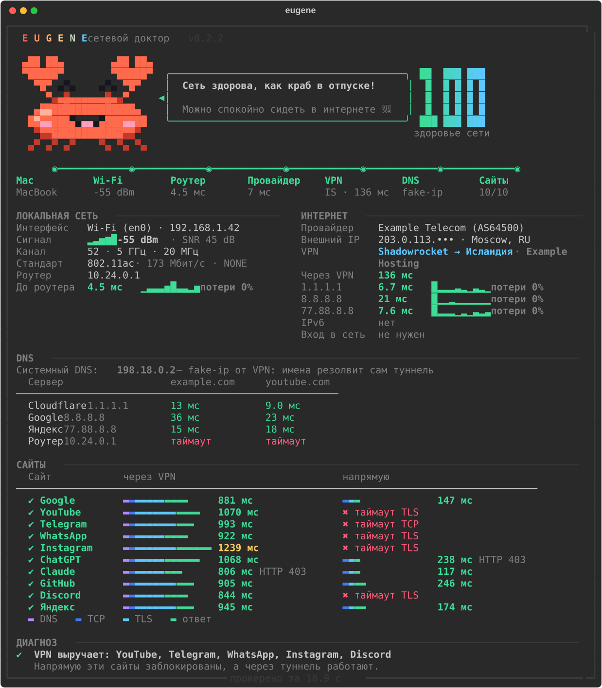
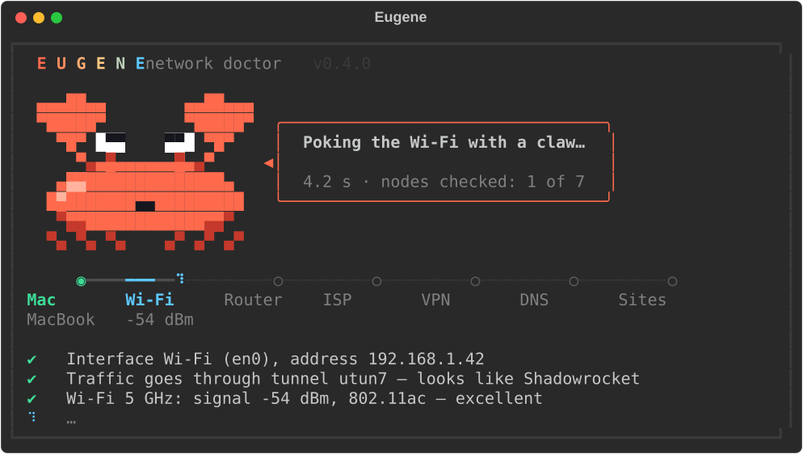
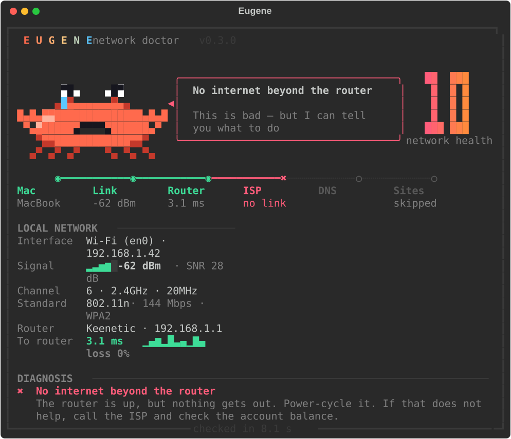

# Eugene

**Eugene is the crab that finds out why the internet is down.**

> "Eugene, what's wrong with the internet?" — and about 15 seconds later you have a diagnosis.

One command, and Eugene checks the whole path from your Mac to the sites you actually use:
Wi-Fi → router → ISP → VPN → DNS → sites. Then it explains, in plain language,
exactly where it broke and what to do about it.



## What it checks

- **Wi-Fi** — signal, noise and SNR, band, channel, standard, and link rate.
- **Router** — latency, jitter, and packet loss. It recognizes Keenetic, MikroTik, ASUS, TP-Link, and others.
- **ISP** — pings to Cloudflare, Google, and Yandex that bypass the VPN, plus the public IP and ISP name.
- **VPN** — sees that traffic goes through a tunnel, recognizes the app (Shadowrocket, Amnezia, Hiddify,
  v2RayTun, Happ, WireGuard, Outline, and others), and shows the exit country and honest tunnel latency.
- **DNS** — speed of the system DNS and public resolvers. It recognizes VPN fake-ip mode (`198.18.x.x`)
  and catches an ISP that rewrites public DNS answers.
- **Sites** — YouTube, Telegram, WhatsApp, Instagram, ChatGPT, Claude, GitHub, Discord, Google, and Yandex,
  staged as DNS → TCP → TLS → response, **through the VPN and directly at the same time**.
  The stage where the connection dies shows whether it is a DNS block, an IP block, or DPI.
- **Captive portal** — notices networks that require a browser sign-in, such as cafes, hotels, and transit.
- **Diagnosis** — a network-health score from 0 to 100, with specific advice.

While the check runs, Eugene walks the chain and comments on what it finds:



When things are genuinely bad, it says so and points to the next call:



## How it works

The key trick on macOS is binding a socket to the physical interface (`IP_BOUND_IF`).
The request then goes **around the VPN tunnel**, and Eugene compares two roads to every site:
through the VPN and directly through the ISP. Internet pings also bypass the tunnel.
TUN clients often answer ICMP themselves, so an ordinary `ping` can show a fantasy 0.4 ms.

No administrator rights are required.

## Install

You need [uv](https://docs.astral.sh/uv/) and Python 3.9+.

```bash
uv tool install git+https://github.com/nikmeee/eugene
```

Run it:

```bash
eugene
```

Without installing:

```bash
uvx --from git+https://github.com/nikmeee/eugene eugene
```

## Options

| Flag | What it does |
| --- | --- |
| `-q`, `--quick` | faster check, fewer pings |
| `-s`, `--site DOMAIN` | check an extra site (repeatable) |
| `--json` | print JSON for scripts and monitoring |
| `--lang ru` or `--lang en` | language; Russian when that is the system language, otherwise English |
| `-V`, `--version` | show the version |

```bash
eugene -s kinopoisk.ru -s twitch.tv
eugene --json | jq '.sites.YouTube'
```

Exit code `1` means network health is below 60, or it could not be scored. Exit code `2`
means the diagnosis itself failed. Both are meant for scripts and monitoring.

## Platforms

Built for **macOS**. On Linux the main checks work, but without Wi-Fi details
and without the "via VPN / direct" comparison.

## For developers

The diagnosis pipeline, threading model, and exit codes are described in
[the architecture document](docs/architecture.md). Releases are recorded in
[CHANGELOG.md](CHANGELOG.md).

## History

Before 0.2 the project was called `netdoctor` and the crab was Klyeshnya. Old repository
links redirect here automatically.

## License

[MIT](LICENSE)
